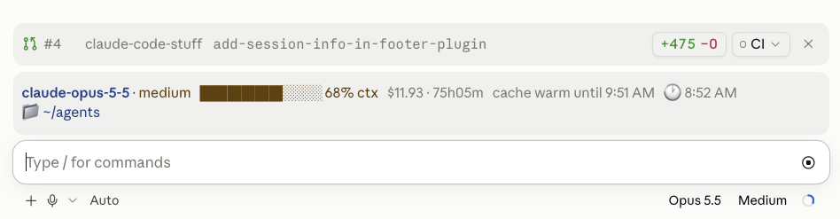
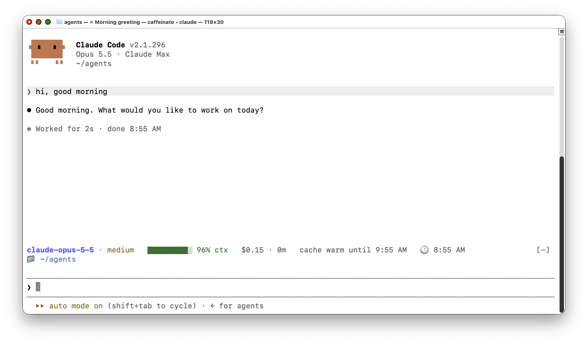
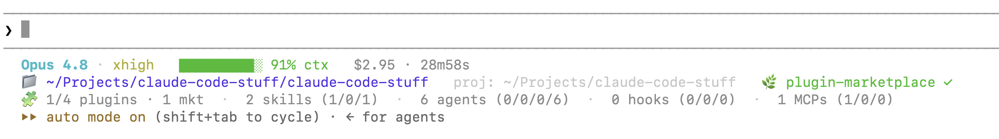

# claude-code-stuff

Justin Pearson's personal Claude Code [plugin marketplace](https://code.claude.com/docs/en/plugin-marketplaces), plus some docs about Claude Code and LLMs + AI in general.

Docs hosted on GH Pages here: https://justinpearson.github.io/claude-code-stuff

## Install + use

Add the marketplace, then install a plugin from it:

```
/plugin marketplace add justinpearson/claude-code-stuff
/plugin install session-info-in-footer@claude-code-stuff
```

The marketplace catalog lives in
[`.claude-plugin/marketplace.json`](.claude-plugin/marketplace.json).

Each plugin holds one feature. Claude Code turns a plugin's skills, hooks, and MCP servers on
and off together, so one feature per plugin lets you enable only the ones you want.

## Plugins

### `session-info-in-footer`

A mod that draws two lines of session information above the prompt, in the terminal and in
the Claude desktop app's Code tab, where a `statusLine` script cannot draw: model, effort,
context left, session cost, elapsed time, current time, directory, and repo. It also shows when
the prompt cache expires and raises a warning five minutes before, suggesting `/compact` if you
are stepping away, since the first message after expiry re-sends the whole context at the
cache-write price. See [`plugins/session-info-in-footer`](plugins/session-info-in-footer).
It has no command to invoke; the band appears in sessions started after you install it.

In the desktop app's Code tab:



In the terminal:



### `screen-recording-demo`

Makes short, silent screen-recording demo videos (and GIFs) of a tool on macOS: a Swift
driver moves the real cursor through the Accessibility API while ffmpeg records a cropped
region, then a renderer adds a title card and numbered captions. Built to keep personal
information out of the frame. See [`plugins/screen-recording-demo`](plugins/screen-recording-demo);
the videos in [easy-file-encryption](https://github.com/justinpearson/easy-file-encryption)
are its output. Invoke it with `/screen-recording-demo:screen-recording-demo`.

### `statusline-setup` (deprecated)

Installs a multi-line status line for the Claude Code terminal app, through a shell script and
a `statusLine` entry in `settings.json`. Superseded by `session-info-in-footer`, which also
works in the desktop app; it remains for its git status and plugin counts. Formerly
`claude-code-setup`; see [`plugins/statusline-setup`](plugins/statusline-setup) for how to
switch an existing install. Invoke it with `/statusline-setup:statusline-setup`.



## Docs

Notes on Claude Code and LLMs / AI, in [`docs/`](docs/), published to GitHub
Pages at <https://justinpearson.github.io/claude-code-stuff>:

- [Happy Justin's Claude Code Tutorial](docs/main.md)
- [User-level Claude Code memory file (my `CLAUDE.md`)](docs/my-CLAUDE.md)

## Other contents

- [`tools/`](tools/) — standalone scripts that are not (yet) packaged as plugins.


## TODO

Things to add:

- /statusline
- CLAUDE.md snippets
- handy skills
- hidden files and folders, hard to find .claude
- handy hooks
	- notifier
- quick-start & tutorial
- disc of user vs proj settings etc
- swimline diagram -- what's an agent, harness, model, etc.
	- different models, harnesses (Pi), ai labs
- LLM Wiki?
- my POV on where software engineering is heading (as of may 2026)
	- ai code review
	- ai software development
		- do you "understand" what it's doing?
	- ai quality-assurance
	- ai security
		- zerodayclock.com, automated systems for CVE fixing
- wiki / posts
	- openclaw
